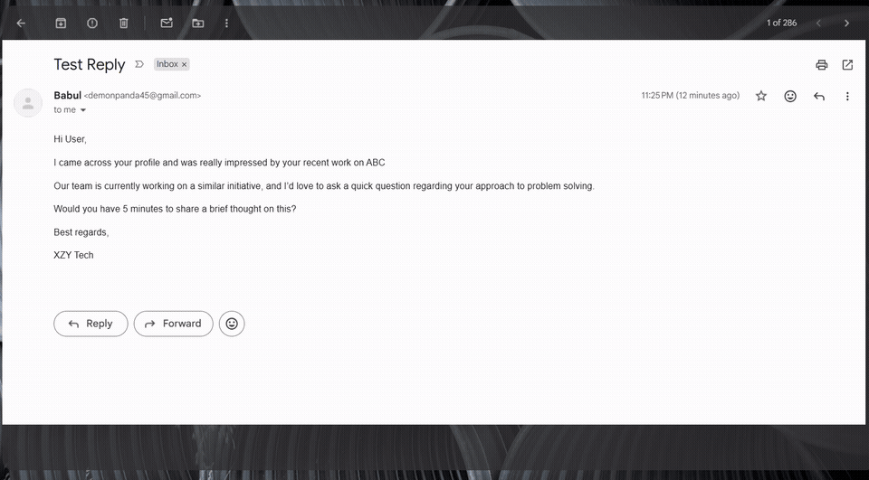
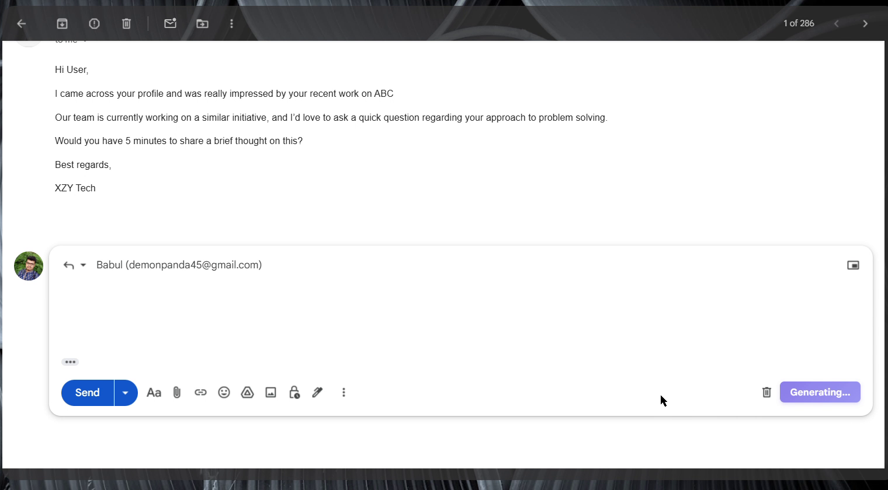
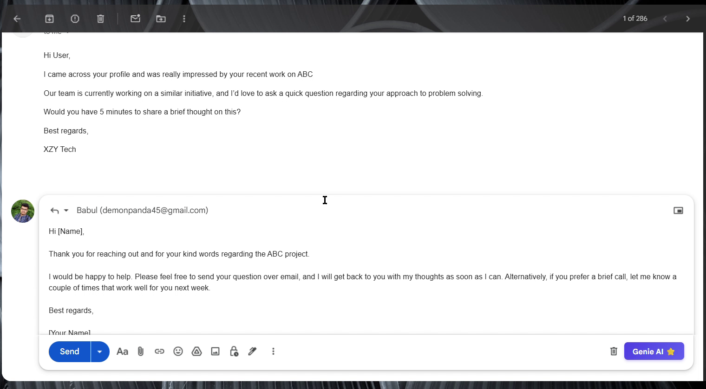
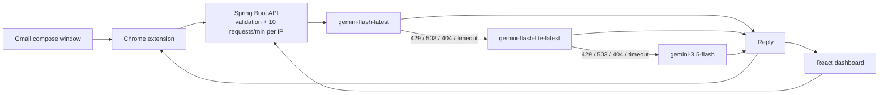

# GmailGenie AI

**GmailGenie AI** generates context-aware email replies inside Gmail. A Manifest V3 Chrome extension and a React dashboard call a Spring Boot REST API that routes requests across several Google Gemini models, falling back automatically on rate limits, overload, retired models, and timeouts. Deployed on Render (API) and Vercel (dashboard).

<p align="center">
  <a href="https://github.com/utkarshkulkarni45/GmailGenie_AI/actions/workflows/ci.yml"></a>
  <a href="LICENSE"></a>
  
  
</p>



| Compose with the extension | Generated reply |
| --- | --- |
|  |  |

---

## Live demo

- **Dashboard:** https://gmail-genie-ai-nine.vercel.app/
- **API health:** https://gmailgenie-ai.onrender.com/actuator/health
- **Extension:** [download the unpacked build](GmailGenie-AI-Extension.zip) and load it in Chrome

The API runs on Render's free tier, so the first request after a period of inactivity can take about 30 seconds while the instance wakes up. Requests after that usually complete in 1–2 seconds.

---

## How it works



The extension watches Gmail's DOM for a compose window, reads the message being replied to, and injects a tone selector and a **Generate Reply** button into the toolbar. The API validates the request, checks the per-IP token bucket, and builds a prompt where the email body sits inside explicit delimiters and is treated as data rather than instructions. The reply is returned as plain text, so it can be dropped straight into Gmail's compose box.

## Features

- **Gmail integration** — Manifest V3 content script, no Gmail API scopes or OAuth consent screen.
- **Tone selection** — professional, friendly, casual, persuasive, or urgent.
- **Model failover** — 429, 503, timeouts, and connection failures move the request to the next model with jittered backoff; other errors fail fast.
- **Per-IP rate limiting** — Bucket4j, 10 requests per minute per address, backed by a bounded Caffeine cache.
- **Bounded input** — `emailContent` is required and limited to 5,000 characters; `tone` is restricted to the five supported values.
- **Observability** — `/actuator/health`, structured JSON errors, and an `X-Model-Used` response header.

## API

### `POST /api/email/generate`

```http
POST /api/email/generate
Content-Type: application/json

{
  "emailContent": "Hi, are you free for a call on Thursday?",
  "tone": "friendly"
}
```

On success the response body is the reply as `text/plain`, and `X-Model-Used` names the model that answered. `X-RateLimit-Limit` and `X-RateLimit-Remaining` accompany every request.

Errors use a consistent JSON shape:

```json
{
  "timestamp": "2026-11-01T10:15:30.123Z",
  "status": 400,
  "error": "Validation Failed",
  "message": "Email content cannot be blank",
  "path": "/api/email/generate"
}
```

| Status | Meaning |
| --- | --- |
| `400` | Missing or invalid request body |
| `429` | Rate limit exceeded; retry after 60 seconds |
| `502` | Every configured model failed |
| `503` | The server has no Gemini API key configured |

CORS allows the deployed Vercel dashboard, `https://mail.google.com`, and localhost development origins.

### `GET /actuator/health`

Returns `{"status":"UP"}` when the application is running. This is the endpoint to use for uptime checks.

## Project layout

- `src/main/java/com/email/writer/` — Spring Boot API (controller, service, rate limiting, error handling)
- `src/test/java/com/email/writer/` — JUnit 5, MockWebServer, and MockMvc tests
- `email-writer-extension/` — Manifest V3 content script and styles
- `email-writer-react/` — React dashboard (Vite + MUI)
- `docs/` — demo GIF and screenshots

## Running locally

Requirements: JDK 21+, Node.js 20+, and a Gemini API key from [Google AI Studio](https://aistudio.google.com/).

### API

```bash
git clone https://github.com/utkarshkulkarni45/GmailGenie_AI.git
cd GmailGenie_AI

# Linux / macOS
export GEMINI_KEY="your_key"
# Windows PowerShell
# $env:GEMINI_KEY = "your_key"

./mvnw spring-boot:run
```

The API listens on `http://localhost:8080`.

### Dashboard

```bash
cd email-writer-react
npm ci
npm run dev
```

Set `VITE_API_URL` if the API is not running on the deployed Render URL, for example `VITE_API_URL=http://localhost:8080/api/email`.

### Extension

1. Open `chrome://extensions/` and enable **Developer mode**.
2. Click **Load unpacked** and select the `email-writer-extension` directory.
3. Open Gmail, start a reply, pick a tone, and click **Generate Reply**.

If the API runs somewhere other than Render, update the URL in `email-writer-extension/content.js` and the host permission in `manifest.json`.

## Configuration

| Variable | Default | Purpose |
| --- | --- | --- |
| `GEMINI_KEY` | none | Gemini API key (required) |
| `GEMINI_MODELS` | `gemini-flash-latest,gemini-flash-lite-latest,gemini-3.5-flash` | Comma-separated failover order |
| `GEMINI_TIMEOUT` | `15s` | Per-model request timeout |
| `PORT` | `8080` | HTTP port |
| `VITE_API_URL` | Render URL | Dashboard API base URL |

See [.env.example](.env.example) for the template.

## Tests and CI

```bash
./mvnw verify
```

The backend tests use OkHttp `MockWebServer` to exercise failover on 503, 429, and timeouts, fail-fast on 400/500, all-models-failed returning 502, and prompt delimiter handling. `MockMvc` tests cover validation and the `X-Model-Used` header. GitHub Actions runs the Maven build and the React production build on every push and pull request to `main`.

## Privacy

To generate a reply, the email text you select is sent from your browser to the API and then to Google's Gemini API. The API holds the text in memory for the duration of the request only: it has no database, writes no email content to logs, and keeps no history. The Gemini key lives only in the server environment, never in the extension. Requests are counted per IP for rate limiting. Render and Vercel keep their own access logs as part of their hosting services.

The API has no user authentication yet, so treat the public deployment as a demo. Do not paste confidential email into it.

## Limitations and roadmap

- **No authentication.** Access is controlled only by IP rate limiting. Google sign-in with per-user quotas is the next step.
- **Not on the Chrome Web Store.** The extension is distributed as an unpacked build.
- **Gmail DOM coupling.** The content script relies on Gmail's current class names and can break when Gmail changes its markup.
- **Free-tier cold starts.** Render suspends idle instances, which adds up to ~30 seconds to the first request.
- **Planned:** OAuth, cached replies for duplicate threads, reply history, and streaming responses.

## License

[MIT](LICENSE) © Utkarsh Kulkarni
