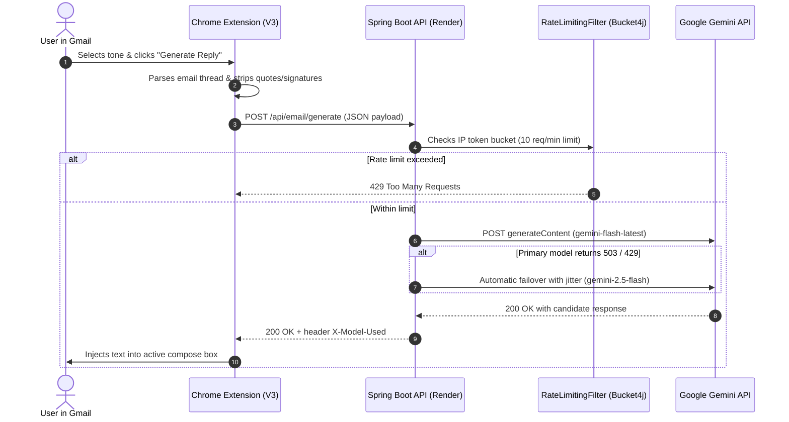

# GmailGenie AI

> **GmailGenie AI** generates context-aware email replies inside Gmail. A Manifest V3 Chrome extension and a React dashboard call a Spring Boot REST API that routes requests across several Google Gemini models, falling back automatically on 429/503 errors. Deployed on Render (API) and Vercel (dashboard).

<p align="center">
  <a href="https://github.com/utkarshkulkarni45/GmailGenie_AI/actions/workflows/ci.yml"></a>
  <a href="LICENSE"></a>
  <a href="https://gmailgenie-ai.onrender.com/actuator/health"></a>
  <a href="https://gmail-genie-ai-nine.vercel.app/"></a>
</p>

---

## Live Links & Demo

- **Web Dashboard**: [https://gmail-genie-ai-nine.vercel.app/](https://gmail-genie-ai-nine.vercel.app/)
- **Backend Health Check**: [https://gmailgenie-ai.onrender.com/actuator/health](https://gmailgenie-ai.onrender.com/actuator/health)

> **Note on Free-Tier Hosting:** Render spins down free instances when idle. The first request after a period of inactivity may take approximately 30 seconds to wake up. Subsequent requests respond within 1–2 seconds.

---

## System Architecture



---

## Features

- **Native Gmail Integration**: Manifest V3 Content Script monitors the compose window using a DOM `MutationObserver` and injects a tone selector and generation button directly into the Gmail action toolbar.
- **Tone Customization**: Tailor responses by mood: `Professional`, `Friendly`, `Casual`, `Persuasive`, and `Urgent`.
- **Resilient Model Failover**: Automatic multi-model fallback sequence (`gemini-flash-latest` → `gemini-2.5-flash` → `gemini-2.5-pro`) with randomized jitter backoff upon encountering HTTP 429 (rate limits) or HTTP 503 (server demand spikes).
- **Per-IP Rate Limiting**: Token-bucket algorithm (Bucket4j) restricting client requests to 10 requests per minute to prevent quota exhaustion.
- **Input Sanitization**: Content length validation (`@Size(max = 5000)`) and delimiter-based prompt encapsulation to defend against prompt-injection attacks.
- **Observability**: Health probing through Spring Boot Actuator (`/actuator/health`) and upstream model tracking returned via the `X-Model-Used` HTTP header.

---

## Project Structure

```
.
├── email-writer-extension/        # Chrome Extension (Manifest V3)
│   ├── manifest.json              # Host permissions & content script definitions
│   ├── content.js                 # DOM observer, thread parsing & tone controls
│   └── content.css                # Injected UI styles
├── email-writer-react/            # Frontend Web App (React 19 + Vite)
│   ├── src/
│   │   ├── components/            # UI components (Form, Reply viewer)
│   │   ├── services/api.js        # HTTP client with timeout handling
│   │   └── App.jsx
│   └── package.json
├── src/main/java/com/email/writer/ # Spring Boot Backend
│   ├── config/RateLimitingFilter.java
│   ├── controller/
│   │   ├── EmailGeneratorController.java
│   │   └── HomeController.java
│   ├── dto/EmailRequest.java, EmailResponse.java, ErrorResponse.java
│   ├── exception/GlobalExceptionHandler.java, ModelServiceException.java
│   └── service/EmailGeneratorService.java
├── Dockerfile                     # Multi-stage production container build
├── pom.xml
└── README.md
```

---

## Local Setup

### Prerequisites
- **JDK 21**
- **Node.js 20+**
- A **Google Gemini API Key** ([Google AI Studio](https://aistudio.google.com/))

### 1. Spring Boot Backend
```bash
# Clone the repository
git clone https://github.com/utkarshkulkarni45/GmailGenie_AI.git
cd GmailGenie_AI

# Copy environment template & provide API key
cp .env.example .env

# Set environment variable (Linux/macOS)
export GEMINI_KEY="your_actual_gemini_key"
# Windows PowerShell:
# $env:GEMINI_KEY = "your_actual_gemini_key"

# Build and run backend
./mvnw clean spring-boot:run
```
The backend API will start on `http://localhost:8080`.

### 2. React Frontend
```bash
cd email-writer-react
npm install
npm run dev
```
Open `http://localhost:5173` in your browser.

### 3. Load Extension in Google Chrome
1. Navigate to `chrome://extensions/` in Chrome.
2. Enable **Developer mode** (top-right toggle).
3. Click **Load unpacked** (top-left) and select the `email-writer-extension` directory.
4. Open [Gmail](https://mail.google.com), click **Compose** or **Reply**, choose a tone, and click **Generate Reply**.

---

## Running Tests

Unit and integration tests for model failover and client error handling run via OkHttp `MockWebServer`:

```bash
./mvnw test
```

---

## Security & Privacy

- **Untrusted Input Handling**: Email text is validated and encapsulated inside strict delimiters within the prompt structure to protect against prompt injection.
- **No Persistence of Private Emails**: Received email bodies are processed transiently in memory to generate replies and are never logged to server logs or persisted to disk.
- **Scoped CORS**: Access to the API is restricted to the deployed Vercel domain, Gmail origin, and local development origins.

---

## Limitations & Roadmap

- **Authentication**: Currently protected by IP rate limiting. Adding Google OAuth2 / Sign-in with Google is planned for multi-tenant user accounts.
- **Chrome Web Store**: Currently distributed as an unpacked developer extension; official Web Store listing is planned.
- **Reply History & Caching**: Response caching for duplicate threads is on the roadmap.

---

## License

This project is licensed under the [MIT License](LICENSE).
